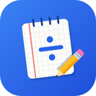
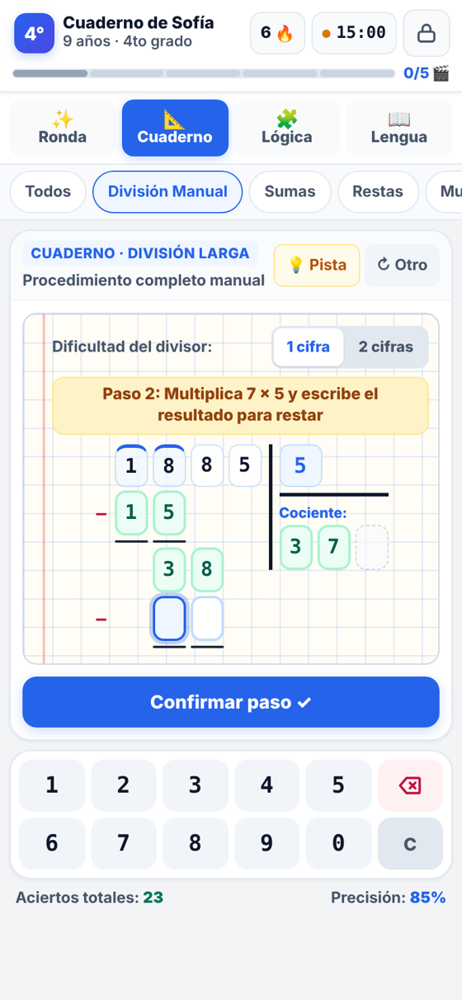
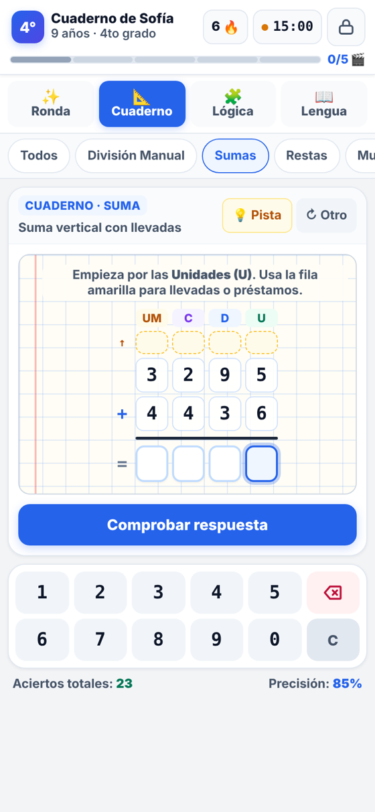
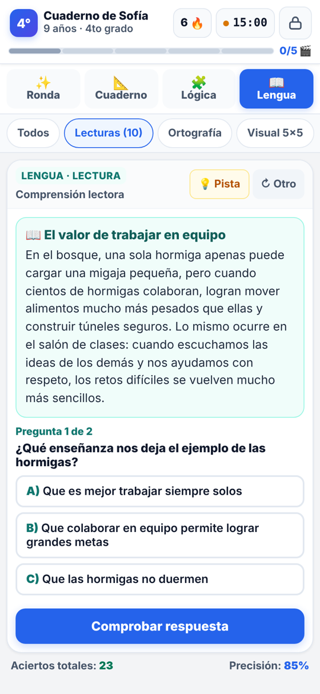
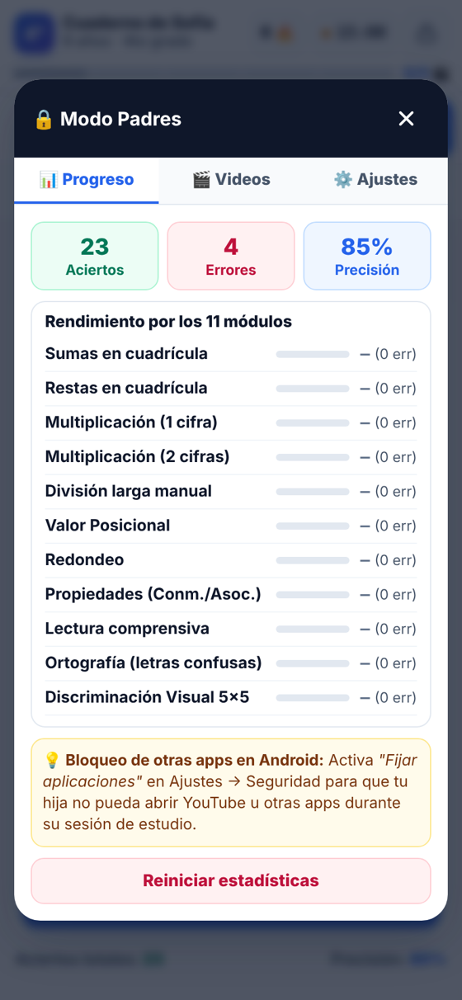

<div align="center">



# Cuaderno Digital

**Un cuaderno de primaria en el teléfono: operaciones en hoja cuadriculada, lógica y lectura,<br/>con un video de premio al terminar cada ronda.**

<br/>

<a href="https://cuaderno-digital-pi.vercel.app">
  
</a>

<br/><br/>

[](https://cuaderno-digital-pi.vercel.app)
[](#-instalarla-en-el-teléfono)
[](#-apk-para-android)
[](https://capacitorjs.com)


</div>

---

<div align="center">

<table>
  <tr>
    <td align="center"><br/><sub><b>División larga paso a paso</b></sub></td>
    <td align="center"><br/><sub><b>Sumas con llevadas</b></sub></td>
    <td align="center"><br/><sub><b>Lectura comprensiva</b></sub></td>
    <td align="center"><br/><sub><b>Modo padres</b></sub></td>
  </tr>
</table>

</div>

## ✨ Qué es

**Cuaderno Digital** es una app para niños de **2º a 6º grado**. Practican como en el cuaderno de papel: escriben cifra por cifra en una hoja cuadriculada, con casillas para las llevadas y los préstamos. La app no les da el resultado: los guía con pistas.

El estudio va por **rondas cortas**. Al completar una ronda se desbloquea un **video educativo** que eligieron los padres, con un temporizador de descanso. Después la app vuelve a la práctica.

## 📚 Módulos

| | Área | Qué practica |
|:-:|---|---|
| 📐 | **Cuaderno** | Sumas con llevadas · Restas con préstamo · Multiplicación de 1 y 2 cifras (con productos parciales) · **División larga manual** en formato de galera: cociente → multiplicar → restar → bajar la cifra |
| 🧩 | **Lógica** | Valor posicional · Redondeo con recta numérica · Propiedades conmutativa y asociativa |
| 📖 | **Lengua** | Lectura comprensiva (10 textos) · Ortografía de letras confusas (b/d, p/q, s/z/c, v/b) · Entrenador visual 5×5 |
| ✨ | **Ronda mixta** | Intercala matemáticas y lengua en rondas de 3, 5, 7 o 10 ejercicios |

## 👨‍👩‍👧 Para padres

- 🔒 **Modo Padres con PIN** con estadísticas por módulo: aciertos, errores y precisión.
- 🎬 **Lista de videos permitidos** de YouTube. Solo se reproducen los que agregues.
- ⏱️ **Tiempos configurables**: duración de la sesión de estudio y de la pausa de video.
- 🎯 **Edad y grado**, que ajustan la dificultad de los ejercicios.
- 💾 **Privacidad**: el progreso se guarda solo en el dispositivo. No hay cuentas, servidores ni anuncios.

> El PIN inicial es **`1234`**. Cámbialo en **Modo Padres → Ajustes** la primera vez.

## 📲 Instalarla en el teléfono

**Desde la web (PWA).** Es la forma más rápida:

1. Abre **[cuaderno-digital-pi.vercel.app](https://cuaderno-digital-pi.vercel.app)** en Chrome.
2. Toca el menú **⋮** y elige **Agregar a pantalla principal**.
3. Se abre a pantalla completa, como una app, y funciona sin internet. Los videos sí necesitan conexión.

### 🤖 APK para Android

El repositorio compila un APK con **Capacitor** mediante GitHub Actions:

1. Ve a **[Actions → Compilar APK Android](https://github.com/Tradester101/Cuaderno-Digital/actions/workflows/build-apk.yml)**.
2. Toca **Run workflow**. La compilación tarda unos 5–8 minutos.
3. Descarga el artefacto **Cuaderno-Digital-APK**, descomprímelo e instala `app-debug.apk`. Hay que permitir la instalación de apps de origen desconocido.

> 💡 Para que tu hija no salga de la app, activa **Fijar aplicaciones** en *Ajustes → Seguridad* de Android.

## ♿ Diseño y accesibilidad

El diseño se revisó con **UI/UX Pro Max** para una app educativa infantil:

- 🎨 La paleta "azul de aprendizaje" `#2563EB` se usa en la app, el ícono y el manifest. Todos los textos cumplen el contraste **WCAG AA** (4.5:1).
- 🔠 Ningún texto mide menos de 12 px y los botones de navegación tienen **36–48 px** de alto.
- ⌨️ Se puede hacer zoom, el foco del teclado es visible, los botones con solo ícono tienen nombre accesible y los modales se cierran con `Esc`.
- 🌀 La app respeta *reducir movimiento*, y la división larga compacta sus casillas para caber en pantallas de **360 px**.

## 🛠️ Tecnología

| | |
|---|---|
| **App** | Un solo `index.html` con HTML, CSS y JavaScript puro, sin frameworks ni librerías |
| **Web** | PWA con `manifest.json` y service worker (red primero y copia offline), alojada en **Vercel** |
| **Android** | **Capacitor 6**, con el APK compilado en **GitHub Actions** |
| **Datos** | `localStorage` del dispositivo |

### Estructura

```
cuaderno-digital/
├── index.html                      La app completa
├── manifest.json                   Datos de la PWA (nombre, colores, íconos)
├── sw.js                           Service worker (solo en la web, no en el APK)
├── icon.svg · icon-*.png           Logo e íconos de la web (incluye maskable)
├── assets/                         Ícono adaptable y splash para Android
├── package.json                    Dependencias de Capacitor
├── capacitor.config.json           Configuración del APK (webDir: www)
├── vercel.json                     Encabezados para Vercel
├── docs/                           Capturas del README
└── .github/workflows/
    └── build-apk.yml               Compilación del APK
```

### Desarrollo local

```bash
python3 -m http.server 8000      # o: npx serve .
# abre http://localhost:8000
```

### Despliegue

Cada push a `main` se publica automáticamente en **[cuaderno-digital-pi.vercel.app](https://cuaderno-digital-pi.vercel.app)**. El sitio no necesita build.

> Para cambiar el logo, reemplaza `icon.svg`, los PNG y los archivos de `assets/`. El workflow regenera los íconos de Android en cada compilación.
>
> Si cambias los íconos o el manifest, sube `CACHE_VERSION` en `sw.js` para que los teléfonos que ya la instalaron descarguen la versión nueva.

---

<div align="center">
<sub>Hecho con 📓 para aprender a mano, aunque sea en pantalla.</sub>
</div>
